# DECK PRESENTASI PROYEK
# Sistem Otomasi & Migrasi Data Logger FTP ke PostgreSQL Realtime

> **Presenter / Technical Lead:** Tim Pengembang Backend  
> **Teknologi Utama:** Node.js, PostgreSQL 18, Socket.IO, Express.js  
> **Target Pengguna:** Operator Lapangan, Tim IT Klien, & Pemangku Kepentingan (*Stakeholders*)

---

## 📌 SLIDE 1: Ringkasan Eksekutif (Executive Summary)

### Latar Belakang & Masalah
* Alat data logger di lapangan secara periodik mengumpulkan data sensor (curah hujan, debit air, getaran, dll.) dan menyimpannya dalam format file terenkapsulasi `.zrx`.
* File-file tersebut dikirimkan ke server FTP secara berkala.
* **Tantangan:** Proses pengolahan manual lambat, berisiko tinggi terjadi data duplikat jika file dikirim ulang, dan tidak ada visualisasi data secara seketika (*realtime*) untuk pengambilan keputusan cepat di lapangan.

### Solusi yang Dibangun
Sistem backend **Event-Driven & Automated Ingestion** berbasis Node.js yang:
1. Mengunduh dan mendeteksi file log baru secara otomatis.
2. Mem-parsing struktur data multi-logger & multi-channel.
3. Menjamin penyimpanan data **100% bebas duplikasi (*idempotent*)** ke PostgreSQL 18.
4. Memancarkan data baru secara langsung (*realtime push*) ke antarmuka pengguna melalui Socket.IO.

---

## 🔄 SLIDE 2: Arsitektur & Alur Kerja Sistem (System Architecture)

Berikut adalah gambaran alur data dari alat logger hingga tampil di layar monitor:

```mermaid
flowchart LR
    A["Alat Logger Lapangan"] -->|"Upload File .zrx"| B["FTP Server / Dropzone"]
    B -->|"Polling Berkala"| C["Cron Watcher (Node.js)"]
    C -->|"Ekstraksi Header & Data"| D["Parser Engine (.zrx)"]
    D -->|"Batch Insert & ON CONFLICT"| E[("Database PostgreSQL 18")]
    E -->|"Emit Event Data Baru"| F["Socket.IO Server"]
    F -->|"Push Update Realtime"| G["Frontend Dashboard Monitor"]
```



### Tahapan Pemrosesan:
1. **Deteksi File:** Watcher memantau kedatangan file baru secara berkala tanpa membebani server (*mutex lock protected*).
2. **Parsing Data:** Memisahkan header stasiun logger, nomor channel, satuan, dan baris timestamp pengukuran.
3. **Penyimpanan Transaksional:** Menggunakan transaksi database ACID untuk memastikan data masuk utuh.
4. **Pencegahan Duplikat:** PostgreSQL secara otomatis menolak data yang sudah pernah dicatat.
5. **Realtime Broadcast:** Frontend langsung memperbarui tampilan grafik/tabel tanpa perlu me-refresh halaman (F5).

---

## 📄 SLIDE 3: Pemrosesan Format Data Logger (.zrx)

File `.zrx` memiliki format spesifik yang terdiri dari blok metadata dan data pengukuran:

### Contoh Struktur Data Mentah:
```text
#REXCHANGEUCL11112_CH01|*|
##CDASA11112|*|CDASANAMEUNILOGCOM|*|
##CCHANNELCH01|*|CCHANNELNO01|*|CUNITmm|*|
20260413202022    0.10
20260413202038    0.10

#REXCHANGEUCL11112_CH02|*|
##CDASA11112|*|CDASANAMEUNILOGCOM|*|
##CCHANNELCH02|*|CCHANNELNO02|*|CUNITmm/min|*|
20260413202022    0.27
```

### Logika Parser yang Diterapkan:
* **Multi-Channel & Multi-Logger:** Mampu membaca beberapa channel sekaligus dalam 1 file (contoh: `CH01` dengan satuan `mm` dan `CH02` dengan satuan `mm/min`).
* **Konversi Timestamp Cerdas:** Mengubah format padat `YYYYMMDDHHmmss` (`20260413202022`) menjadi standar SQL Timestamp `2026-04-13 20:20:22`.
* **Validasi Ketat:** Memvalidasi kewajaran kalender serta memastikan nilai sensor merupakan angka desimal valid sebelum disimpan.

---

## 🛡️ SLIDE 4: Keunggulan Teknis & Keandalan Sistem

| Fitur Utama | Implementasi Teknis | Keuntungan Bisnis |
| :--- | :--- | :--- |
| **Pencegahan Duplikasi (Idempotency)** | `INSERT ... ON CONFLICT (id_logger, channel, recorded_at) DO NOTHING` | File yang diunggah berulang kali tidak akan menduplikasi angka di database |
| **Integritas Data Transaksional** | PostgreSQL Transaction (`BEGIN` ... `COMMIT` / `ROLLBACK`) | Jika terjadi kesalahan di tengah file, tidak ada data setengah jadi yang tertinggal |
| **Kinerja Skalabilitas Tinggi** | Batch Parameterized Query (Chunking 500 baris) & Connection Pooling | Mampu menangani puluhan ribu baris per detik dengan konsumsi memori hemat |
| **Keamanan Berlapis** | Environment Variables (`.env`) & Parameterized SQL | Credential aman dari kebocoran, 100% terlindung dari serangan SQL Injection |
| **Arsitektur Watcher Aman** | Mutex Flag (`isProcessing`) | Mencegah pembacaan file bertabrakan jika file logger berukuran besar |

---

## 🖥️ SLIDE 5: Antarmuka Monitor Realtime (Frontend Dashboard)

Dashboard dirancang dengan pendekatan **Clean Editorial Minimalism**:

### Fitur Tampilan:
1. **Bebas Warna Menyilaukan (Zero Neon):** Menggunakan palet *warm cream* dan *charcoal* yang tenang dan elegan, menjamin kenyamanan visual operator yang memantau layar dalam durasi lama.
2. **Fitur Dark Mode Bawaan:** Dilengkapi tombol toggle instan Mode Terang / Gelap dengan penyimpanan persisten di browser (*localStorage*).
3. **Live Stream Realtime:** Setiap kali alat logger mengirim data baru, baris tabel akan muncul menyala lembut secara live via **Socket.IO**.
4. **Metrik Terintegrasi:** Menampilkan total data di database, jumlah logger aktif, channel aktif, dan event masuk secara langsung.

---

## 📊 SLIDE 6: Hasil Pengujian Sistem (Verification & Testing)

Semua komponen telah melalui serangkaian pengujian terukur (*automated test scripts*):

1. **Uji Koneksi Database & Skema (`test:db`):**
   * PostgreSQL 18.6 berhasil terhubung.
   * Constraint unik `uq_arr_ftp_logger_channel_recorded` terverifikasi aktif.
2. **Uji Ekstraksi Parser (`test:parser`):**
   * File contoh [`.UCL11112_20260413_203000.zrx`](file:///c:/Users/ECHA/ftp-migration/.UCL11112_20260413_203000.zrx) diproses.
   * **Hasil:** 44 record pengukuran terekstrak sempurna dari 2 channel (CH01 & CH02) dengan 0 error.
3. **Uji Pencegahan Duplikasi Database (`test:insert`):**
   * *Insert pertama:* 44 baris berhasil masuk ke database.
   * *Insert kedua (file sama):* **0 baris masuk, 44 baris diabaikan (DO NOTHING)**. Integritas data terbukti aman.
4. **Uji Simulasi Otomasi (`test:sim`):**
   * File baru dimasukkan ke folder incoming &rarr; terdeteksi otomatis &rarr; masuk ke database &rarr; file otomatis diarsipkan ke folder `processed`.

---

## 🚀 SLIDE 7: Rencana Tahap Lanjut (Next Steps to Production)

Untuk meluncurkan sistem ini ke server produksi klien, langkah yang tersisa sangat sederhana:

1. **Konfigurasi Kredensial FTP Klien:**
   * Memasukkan alamat IP host FTP, username, dan password ke file `.env`.
   * Menyesuaikan protokol (FTP biasa / FTPS dengan TLS / SFTP).
2. **Deployment Server Produksi:**
   * Menjalankan service menggunakan Process Manager seperti **PM2** atau container **Docker** agar sistem berjalan 24/7 tanpa henti (*auto-restart on failure*).
3. **Integrasi Dashboard Klien:**
   * Tim pengembang frontend klien dapat langsung memanfaatkan API endpoint (`/api/measurements`) dan Socket.IO (`new_measurement`) yang telah siap digunakan.

---

## 💡 SLIDE 8: Kesimpulan

> Proyek ini telah berhasil menyelesaikan seluruh target inti: **Sistem otomatisasi yang andal, aman dari duplikasi data, berkinerja tinggi, dan siap diintegrasikan untuk kebutuhan monitoring masa kini.**

